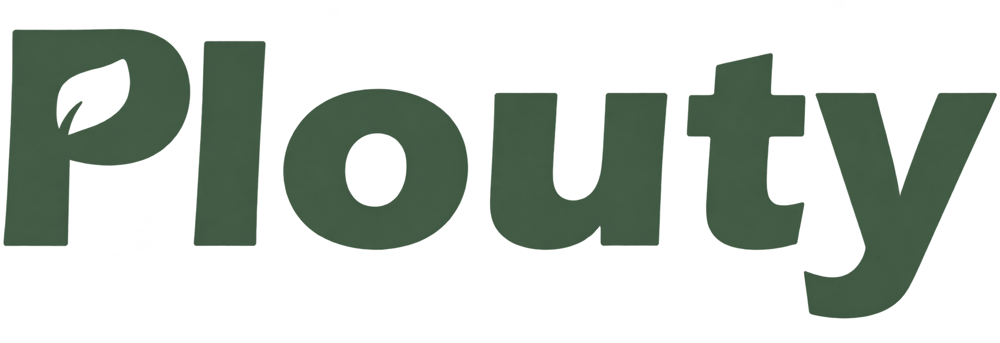

<div align="center">
  
  <h1>Plouty</h1>
</div>

A **Plouty** é um projeto acadêmico desenvolvido para a **FIAP**, alinhado à **ODS 2 — Fome Zero e Agricultura Sustentável**. O protótipo apresenta uma rede profissional agrícola que aproxima pequenos produtores rurais e instituições compradoras, organizando conexões, reputação e descoberta de fornecedores em uma experiência digital acessível e voltada ao contexto brasileiro.

<div align="center">
  <h2>Equipe</h2>
  <p>
    Davi Rabelo<br>
    Enzo Mitev<br>
    Felipe Domingues<br>
    Marcris Filho<br>
    Nicolas Mantovani
  </p>
</div>

## 🌱 Relação com a ODS 2

O projeto acadêmico está alinhado à **ODS 2 — Fome Zero e Agricultura Sustentável**, um dos Objetivos de Desenvolvimento Sustentável da ONU.

A proposta é contribuir para cadeias de abastecimento mais próximas e transparentes, fortalecendo a agricultura familiar e facilitando o acesso de escolas, hospitais, restaurantes e outras instituições a alimentos produzidos regionalmente.

## Objetivo da plataforma

A Plouty busca criar um ambiente profissional baseado em confiança, no qual produtores e instituições possam se conhecer, avaliar informações comerciais e iniciar relações de fornecimento com menos barreiras.

O protótipo atual concentra-se na apresentação dessa experiência, utilizando perfis e dados demonstrativos locais, sem backend ou autenticação real.

## ✨ Funcionalidades atuais

- entrada demonstrativa com escolha entre produtor/cooperativa e instituição, permitindo operar qualquer um dos 14 perfis;
- sessão local mantida durante a aba atual do navegador;
- feed social interativo com criação de publicações em tempo real e persistência local;
- edição e exclusão das próprias publicações, com confirmação antes de excluir;
- curtidas, comentários e republicações persistidos localmente e refletidos no feed e nos perfis;
- filtros de publicações recentes, conexões e oportunidades, com demandas em destaque;
- upload e pré-visualização de fotografias no compositor de postagens;
- sistema de comentários interativos com respostas dinâmicas em cada publicação;
- ações de curtir, republicar e compartilhar com contadores atualizados em tempo real;
- central de demandas ODS 2 com criação, edição e encerramento por compradores;
- envio de propostas por produtores e cooperativas, com preço, quantidade, prazo e observações;
- aceite e recusa pelo comprador, com status sincronizados na página **Negociações**;
- mensagens persistidas localmente e vinculadas aos perfis, demandas e propostas por ID;
- central de notificações locais para conexões, curtidas, comentários, propostas e mensagens, com leitura individual ou em lote;
- configurações por perfil para tema, preferências de notificações e visualização mobile no computador;
- botão de tela cheia na interface mobile quando a Fullscreen API está disponível;
- restauração confirmada dos dados demonstrativos, preservando as preferências de cada perfil;
- resumo do usuário, assuntos em pauta e sugestões de conexão;
- catálogo de produtores, cooperativas e compradores institucionais;
- busca por nome, produto, localização ou descrição;
- busca global de usuários, produtos e demandas em `/buscar`;
- exploração de produtores, cooperativas e compradores com filtros por categoria, região e produto;
- filtros por tipo de produção, região e avaliação mínima;
- cards comerciais com reputação, entregas, disponibilidade e verificações;
- painel responsivo de mensagens com conversas demonstrativas e direcionadas;
- perfis profissionais em `/perfil/:id`, com capa, apresentação, produtos, reputação, conexões e publicações;
- acesso a **Meu perfil** pelo menu de usuário e edição local de identidade, apresentação, produtos, contato e capacidade de fornecimento;
- alterações do perfil refletidas no feed, nas demandas, no catálogo e nas mensagens por meio do ID do usuário;
- navegação para perfis por nomes e avatares no feed, nas demandas, no catálogo e nas mensagens;
- 14 perfis fictícios de produtores, cooperativas e compradores, vinculados a publicações e interações por identificadores únicos;
- avatares demonstrativos com iniciais; três publicações mostram um espaço gráfico 16:9 para imagem demonstrativa, e as demais permanecem textuais, sem fotografias geradas;
- rede profissional em **Minha Rede**, com conexões, solicitações recebidas e enviadas, sugestões e busca por nome, atuação e localização;
- envio, cancelamento, aceite e recusa de solicitações; remoção de conexão com confirmação; estados sincronizados entre perfil, feed e rede;
- conexões e solicitações demonstrativas compartilhadas pelos 14 perfis e salvas no armazenamento local do navegador;
- ação demonstrativa de mensagem;
- formulário de contato com validação local;
- temas claro e escuro;
- navegação responsiva para desktop, tablet e celular;
- avatares com iniciais; apenas logo e imagem institucional locais. Fotografias podem ser adicionadas pelo próprio usuário às publicações.

## 🧰 Tecnologias utilizadas

- **React 18**;
- **Vite 6**;
- **React Router 7**;
- **Bootstrap 5**;
- **Bootstrap Icons**;
- **Context API** para sessão, perfis, rede, feed, comércio, notificações e preferências;
- **JavaScript**, **HTML**, **CSS/SCSS** com tokens para temas claro e escuro.

## Páginas disponíveis

- **`/`** — entrada pública da demonstração;
- **`/entrar`** — formulário de acesso e seleção do perfil demonstrativo;
- **`/inicio`** — feed social da rede Plouty, protegido pela sessão local;
- **`/demandas`** — central de demandas e cotações da agricultura familiar (ODS 2), protegida pela sessão local;
- **`/explorar`** — catálogo de produtores, cooperativas e compradores, protegido pela sessão local;
- **`/perfil/:id`** — perfil profissional demonstrativo; o perfil da sessão permite edição local;
- **`/buscar`** — resultados globais de perfis, produtos e demandas;
- **`/minha-rede`** — conexões, solicitações, sugestões e busca da sessão demonstrativa;
- **`/negociacoes`** — propostas recebidas e enviadas, decisões e conversa com a outra parte;
- **`/notificacoes`** — atividades locais e acesso ao conteúdo relacionado;
- **`/configuracoes`** — conta demonstrativa, aparência, notificações e restauração dos dados;
- **`/sobre`** — apresentação institucional da Plouty e de sua relação com a ODS 2;
- **`/contato`** — canal demonstrativo de contato e suporte.

Produtores e instituições podem acessar as áreas protegidas. Quando não existe uma sessão demonstrativa ativa, o acesso direto a essas páginas redireciona para a entrada.

Para testar uma negociação, entre como **Instituição** (Escola Caminhos do Saber) e crie uma demanda. Saia pelo menu do usuário, entre como **Produtor ou cooperativa** (João Carlos ou uma cooperativa) e envie uma proposta. Volte ao perfil comprador para aceitar ou recusar em **Negociações**. As alterações ficam no `localStorage` do navegador.

## 🚀 Instalação e execução

### Pré-requisitos

- Node.js 18 ou superior instalado;
- npm disponível no terminal.

### Executar em desenvolvimento

```bash
npm install
npm run dev
```

A aplicação será disponibilizada em:

```text
http://localhost:3000
```

### Verificações e versão de produção

```bash
npm run build
npm run check:data
npm run check:network
npm run preview
```

`npm run preview` inicia uma cópia local da versão gerada em `dist/`. As verificações de dados e rede são scripts Node sem serviços externos.

### Deploy na Vercel

Importe este repositório como projeto **Vite** na Vercel. Use `npm run build` como comando de build e `dist` como diretório de saída. O arquivo `vercel.json` redireciona URLs do React Router para `index.html`, permitindo abrir ou atualizar rotas como `/perfil/joao-carlos` diretamente. Seus cabeçalhos permitem a prévia mobile em iframe da mesma origem. Não são necessárias variáveis de ambiente nem banco de dados. O armazenamento é local a cada navegador e não é compartilhado entre visitantes.

No Windows, caso o PowerShell bloqueie o comando `npm`, utilize `npm.cmd` nos mesmos comandos.

## 📁 Estrutura resumida

```text
Plouty-Connecting/
├── public/
│   └── images/             # Logos e imagem institucional
├── src/
│   ├── components/         # Componentes comuns, sociais, de layout e exploração
│   ├── context/            # Sessão, tema, perfis e estados locais da rede
│   ├── data/               # Mocks estáveis utilizados pela interface
│   ├── utils/              # Persistência local e utilitários das interações
│   ├── hooks/              # Hooks reutilizáveis
│   ├── pages/              # Páginas atualmente disponíveis
│   ├── styles/             # Tokens e estilos globais da aplicação
│   ├── App.jsx             # Rotas e composição principal
│   └── main.jsx            # Inicialização do React
├── index.html
├── package.json
├── vercel.json             # Rewrite de SPA e cabeçalhos de segurança
└── vite.config.js
```

## ⚠️ Caráter demonstrativo e limitações

Este repositório representa um **protótipo de interface**. Atualmente:

- não existe backend ou banco de dados persistente em nuvem;
- os dados inseridos (publicações, fotos locais, comentários, demandas, conexões, notificações e edições do perfil) são gerenciados no estado ou no `localStorage` do navegador;
- o perfil selecionado é armazenado em `sessionStorage` para fins de demonstração acadêmica;
- as conversas fictícias iniciais são estáticas; novas mensagens, demandas e propostas persistem neste navegador;
- o formulário de contato valida os dados localmente;
- os dados de reputação, entregas, perfis e instituições são fictícios e demonstrativos.

## 🗺️ Funcionalidades planejadas para fases futuras

As próximas fases poderão incluir:

- backend e autenticação de usuários;
- persistência compartilhada de perfis, publicações, mensagens e conexões;
- notificações e dados sincronizados entre dispositivos;
- contratos reais, pagamentos e acompanhamento de entregas;
- avaliações verificadas e reputação calculada a partir de transações reais.

Essas funcionalidades fazem parte da evolução planejada e **não estão implementadas no estado atual do projeto**.
---

<div align="center">
  Projeto acadêmico desenvolvido com foco em agricultura sustentável, confiança e impacto social.
</div>
